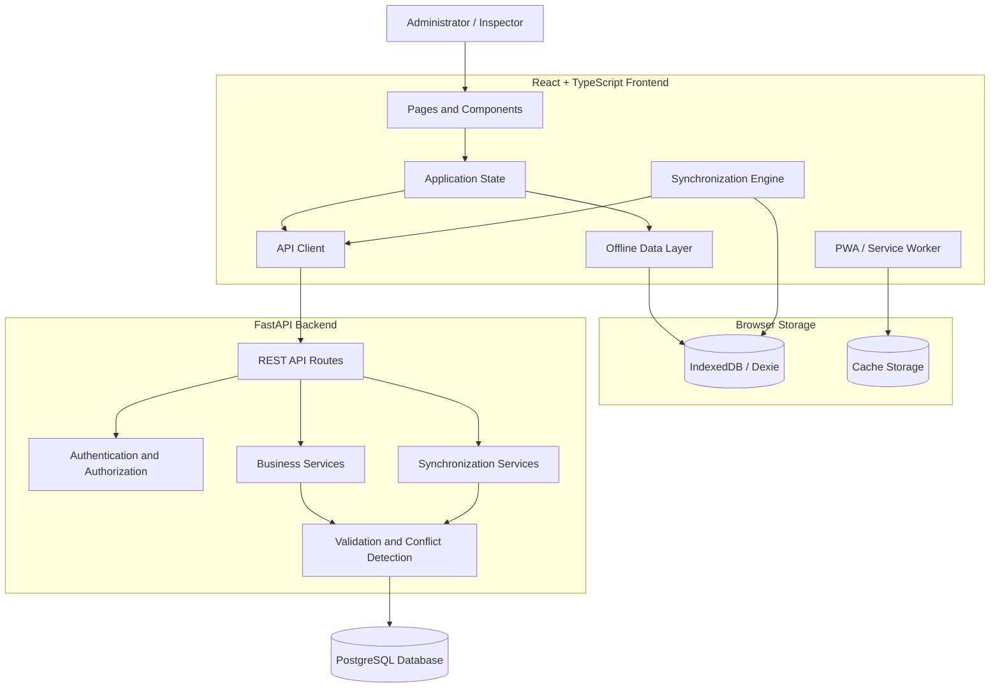
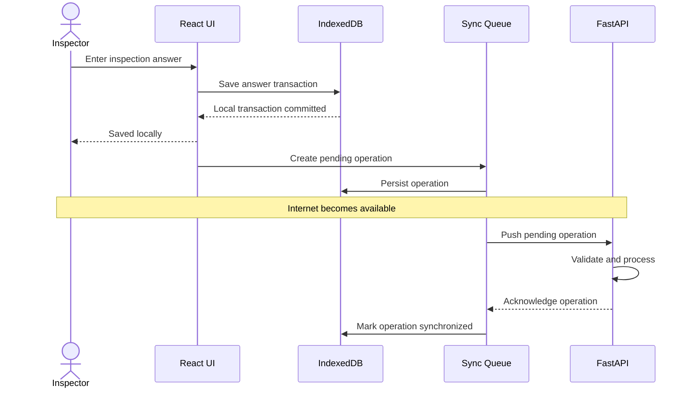
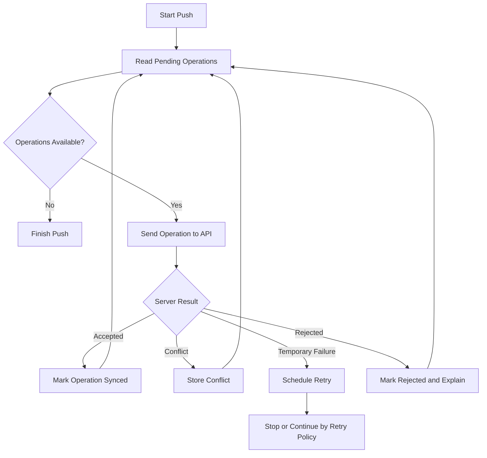
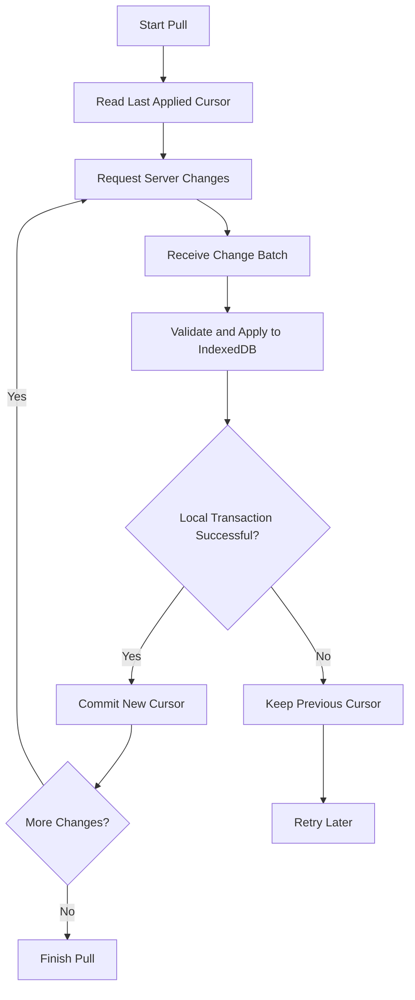
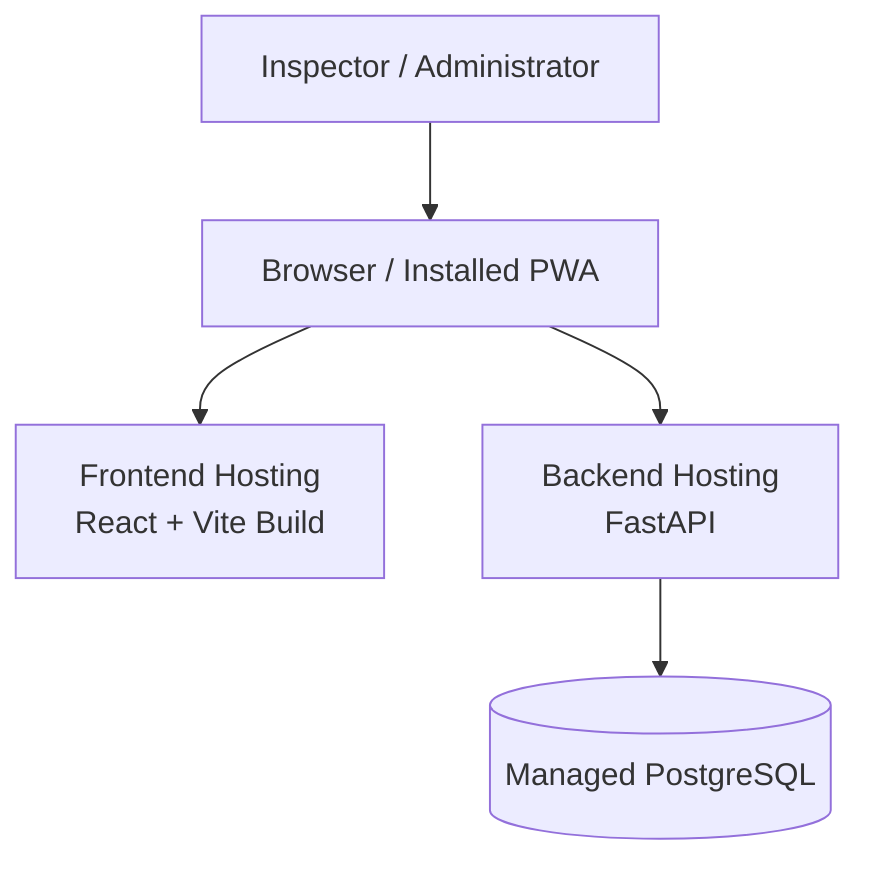

# Fieldmark — System Architecture

## 1. Document Purpose

This document defines the technical architecture of **Fieldmark**, an offline-capable field inspection application.

It explains:

- The overall system structure.
- Frontend and backend responsibilities.
- Database and local storage responsibilities.
- Offline-first application behavior.
- Bidirectional synchronization.
- Authentication and authorization.
- Conflict detection and resolution.
- Error handling and reliability.
- Deployment architecture.

This document is the technical reference for developers and AI coding assistants implementing Fieldmark.

---

## 2. Project Overview

### 2.1 Application Description

Fieldmark allows field inspectors to perform inspections at locations where internet connectivity may be unavailable or unreliable.

An inspector must be able to:

1. Log in while connected to the internet.
2. Download assigned inspections and required reference data.
3. Open the application without an internet connection.
4. Complete inspections and save answers locally.
5. Close or refresh the application without losing saved work.
6. Reconnect to the internet.
7. Synchronize local changes with the central server.
8. Receive updated server-side information.
9. Identify and resolve synchronization conflicts.

Administrators manage users, sites, checklist templates, and inspection assignments.

### 2.2 Architecture Principles

Fieldmark must follow these principles:

1. **Offline-first:** Local application functionality must not depend on a continuous internet connection.
2. **Local durability:** User changes must be persisted in IndexedDB before the UI reports them as saved.
3. **Server authority:** PostgreSQL is the central source of truth for shared application data.
4. **Explicit synchronization:** Local and remote changes must be synchronized through controlled APIs.
5. **Idempotency:** Retrying an operation must not create duplicate records or duplicate effects.
6. **Conflict awareness:** Concurrent modifications must be detected rather than silently overwritten.
7. **Security:** Authentication, authorization, and data ownership must be enforced by the backend.
8. **Recoverability:** Failed synchronization must be retryable without losing user data.
9. **Maintainability:** Frontend, backend, database, and synchronization responsibilities must remain separated.
10. **Testability:** Offline behavior, synchronization, retries, and conflicts must be independently testable.

---

## 3. Technology Stack

### 3.1 Frontend

| Technology | Responsibility |
|---|---|
| React | Component-based user interface |
| TypeScript | Static typing and safer application development |
| Vite | Frontend development and build tooling |
| React Router | Client-side navigation |
| Tailwind CSS | Styling and responsive layouts |
| shadcn/ui | Reusable UI components |
| TanStack Query | Server-state and API request management |
| Zustand | Client-side application state |
| Dexie.js | IndexedDB database management |
| React Hook Form | Form management |
| Zod | Client-side schema validation |
| Axios | HTTP communication |
| Workbox or compatible tooling | Service worker and PWA support |
| Vitest | Unit and component testing |
| Playwright | End-to-end testing |

### 3.2 Backend

| Technology | Responsibility |
|---|---|
| Python | Backend programming language |
| FastAPI | REST API framework |
| Pydantic | Request and response validation |
| SQLAlchemy | Database ORM |
| Alembic | Database migrations |
| PostgreSQL | Central relational database |
| JWT | Access-token authentication |
| Argon2id | Password hashing |
| Pytest | Backend testing |
| HTTPX | API integration testing |

### 3.3 Local Storage

| Technology | Responsibility |
|---|---|
| IndexedDB | Persistent browser-side application data |
| Dexie.js | Structured access to IndexedDB |
| Service Worker | Application caching and offline loading |
| Browser Cache Storage | Static asset caching |

### 3.4 Version Management

Do not assume that the newest version of every dependency is automatically compatible with the others.

During implementation:

- Check the official stable releases.
- Select mutually compatible versions.
- Avoid prerelease versions unless explicitly approved.
- Pin dependencies in the appropriate package and Python dependency files.
- Commit lockfiles.
- Record important version decisions in the project documentation.

---

## 4. High-Level System Architecture

Fieldmark uses a client-server architecture with an offline-first frontend.

The browser application contains its own local database and synchronization engine. The backend provides authenticated REST APIs and manages central data in PostgreSQL.

### 4.1 Architecture Diagram



### 4.2 Main Components

**Frontend UI**

Displays dashboards, inspection lists, inspection forms, user management, site management, and synchronization status.

**Application State**

Manages temporary UI state such as selected navigation items, open dialogs, current filters, and other interactive state.

**API Client**

Communicates with FastAPI using authenticated HTTP requests.

**Offline Data Layer**

Reads and writes application records in IndexedDB.

**Synchronization Engine**

Pushes local changes to the backend and pulls remote changes into IndexedDB.

**Service Worker**

Caches the application shell and static resources so that the application can load without a network connection.

**FastAPI Backend**

Provides authentication, business logic, validation, data access, and synchronization endpoints.

**PostgreSQL**

Stores centrally managed users, sites, inspection templates, assignments, results, and synchronization metadata.

---

## 5. Frontend Architecture

The frontend is responsible for the user experience and offline application behavior.

It must not directly communicate with PostgreSQL.

All remote communication must happen through FastAPI APIs.

### 5.1 Frontend Responsibility Layers

```text
React Pages and Components
          |
          v
Application State
          |
          v
Application Services
          |
          +---------------------+
          |                     |
          v                     v
       API Client          Offline Repository
          |                     |
          v                     v
      FastAPI API          IndexedDB
          |
          v
      PostgreSQL
```

### 5.2 Frontend Modules

**Authentication Module**

Responsibilities:

- Login.
- Logout.
- Session restoration.
- Access-token handling.
- Refresh-token handling.
- Offline access policy.

**Dashboard Module**

Responsibilities:

- Display assigned inspections.
- Display inspection summaries.
- Display pending synchronization counts.
- Display recent activity.

**Inspection Module**

Responsibilities:

- Display inspection assignments.
- Open inspection forms.
- Load checklist items.
- Save inspection answers.
- Track draft and submission status.

**Site Management Module**

Responsibilities:

- Display available sites.
- Show site information.
- Cache authorized site data locally.

**Template Module**

Responsibilities:

- Display checklist templates.
- Load checklist items.
- Cache required template versions.

**Synchronization Module**

Responsibilities:

- Detect pending local changes.
- Queue operations.
- Push operations.
- Pull server changes.
- Retry failed operations.
- Detect conflicts.
- Update synchronization status.

**Settings Module**

Responsibilities:

- Display account information.
- Display device information.
- Display storage and synchronization information.
- Provide logout functionality.

### 5.3 Frontend Data Access Rule

React components must not directly access IndexedDB or make arbitrary API calls throughout the UI.

Use clearly separated layers:

- Components display information.
- Hooks connect components to application services.
- Repositories manage local persistence.
- API clients communicate with the backend.
- Synchronization services coordinate local and remote data.

This separation makes the application easier to test and maintain.

---

## 6. Backend Architecture

The backend uses a layered architecture.

```text
HTTP Request
     |
     v
API Router
     |
     v
Authentication / Authorization
     |
     v
Pydantic Validation
     |
     v
Service Layer
     |
     v
Repository / Database Access
     |
     v
PostgreSQL
     |
     v
HTTP Response
```

### 6.1 API Router Layer

Responsible for:

- Defining API endpoints.
- Reading path parameters and query parameters.
- Receiving request bodies.
- Calling service functions.
- Returning standardized responses.

Routers should not contain complex business logic.

### 6.2 Authentication and Authorization Layer

Responsible for:

- Validating access tokens.
- Identifying the authenticated user.
- Enforcing role-based permissions.
- Checking ownership and resource access.
- Preventing unauthorized synchronization.

The initial roles are:

- `ADMIN`
- `INSPECTOR`

### 6.3 Validation Layer

Responsible for:

- Validating incoming data.
- Enforcing business rules.
- Checking required fields.
- Checking supported status transitions.
- Checking record versions.
- Rejecting invalid synchronization operations.

Validation must happen on the server even if the frontend has already validated the same data.

### 6.4 Service Layer

Responsible for business operations such as:

- Creating users.
- Managing sites.
- Creating checklist templates.
- Assigning inspections.
- Submitting inspections.
- Processing synchronization operations.
- Resolving conflicts.

### 6.5 Repository / Database Layer

Responsible for:

- Reading records from PostgreSQL.
- Creating records.
- Updating records.
- Deleting records where permitted.
- Managing database transactions.
- Applying concurrency checks.

### 6.6 Synchronization Service

This is a dedicated backend subsystem.

It must handle:

- Incoming synchronization operations.
- Idempotency checks.
- Authorization checks.
- Entity version validation.
- Conflict detection.
- Transactional data updates.
- Change-feed creation.
- Pull requests.
- Synchronization acknowledgements.

Synchronization logic must not be scattered across unrelated API routers.

---

## 7. Database Architecture

PostgreSQL is the central database for Fieldmark.

The initial database name is:

```text
field_inspection_db
```

### 7.1 Initial Database Tables

The initial design identifies these tables:

| Table | Purpose |
|---|---|
| `users` | User accounts and roles |
| `refresh_tokens` | Refresh-token/session records |
| `sites` | Inspection locations |
| `inspections` | Inspection assignments and lifecycle |
| `checklist_templates` | Checklist definitions |
| `checklist_items` | Individual checklist questions |
| `inspection_results` | Inspection result or submission records |
| `inspection_answers` | Answers to checklist questions |
| `sync_operations` | Server-side idempotency records |
| `sync_devices` | Registered client devices |
| `sync_conflicts` | Recorded synchronization conflicts |
| `sync_changes` | Server-side change feed |

The detailed relationships, constraints, indexes, and field definitions will be finalized in `database-design.md`.

### 7.2 Server-Side Data Authority

PostgreSQL is the central source of truth for shared data.

However, an inspector must be able to work with authorized, previously downloaded information while offline.

This means:

- The frontend can temporarily contain changes that are not yet on the server.
- Local records must be preserved until synchronization is acknowledged.
- Server-side validation determines whether incoming changes can be accepted.
- Local data must not be treated as globally synchronized merely because it was saved successfully in IndexedDB.

---

## 8. Offline-First Architecture

Offline support is a core requirement, not an optional enhancement.

The application must work when:

- Internet connectivity is unavailable.
- The connection is unstable.
- The user moves between online and offline environments.
- The browser refreshes.
- The application is closed and reopened.

### 8.1 Local-First Write Flow

When an inspector saves an answer:



The local transaction must complete before the UI displays a successful local-save confirmation.

### 8.2 Local Data Storage

Use IndexedDB through Dexie.js.

Store the following categories of information locally:

- Cached user and session metadata.
- Authorized site records.
- Checklist templates.
- Inspection assignments.
- Inspection drafts.
- Inspection answers.
- Local synchronization metadata.
- Pending operations.
- Conflict records.
- Last successfully applied server cursor.

Local data must be scoped to the authenticated user and device.

### 8.3 Offline Application Loading

Use a service worker to cache the application shell and necessary static assets.

The service worker should cache:

- Application entry points.
- JavaScript bundles.
- CSS files.
- Fonts and icons.
- Other essential static assets.

Do not assume that caching the frontend automatically makes API data available offline. Business data must be explicitly persisted in IndexedDB.

### 8.4 Offline Authentication Policy

Offline access must be bounded.

An inspector can access offline functionality only after a successful online authentication and local initialization.

The application should maintain a protected local session context with:

- User identifier.
- User role at last successful authentication.
- Device identifier.
- Last successful authentication time.
- Configured offline access expiry.

Important security rules:

1. Offline access must expire according to a configurable policy.
2. The frontend cannot verify whether the user's server-side account or role has changed while disconnected.
3. Sensitive administrative operations must require an online server authorization check.
4. Refresh tokens must not be exposed to JavaScript storage unnecessarily.
5. On reconnection, the server must revalidate the user's current account status and permissions.
6. If the account is disabled or the session is revoked, synchronization must be rejected and the application must follow its defined data-protection policy.

Offline access is a limited capability, not a replacement for server-side authentication.

---

## 9. Synchronization Architecture

Fieldmark requires bidirectional synchronization.

There are two primary operations:

1. Push: send locally created or updated data to the server.
2. Pull: receive server-side changes and apply them locally.

### 9.1 Synchronization Components

**Local Repository**

Stores application data in IndexedDB.

**Operation Queue**

Stores changes that must be sent to the backend.

**Sync Coordinator**

Controls when synchronization starts and prevents overlapping synchronization runs for the same local context.

**Push Processor**

Sends pending operations to the backend.

**Pull Processor**

Downloads changes from the server.

**Conflict Handler**

Stores and manages changes that cannot be automatically reconciled.

**Retry Handler**

Retries recoverable failures using controlled backoff.

### 9.2 Push Flow



Push requirements:

- Every operation must have a unique operation ID.
- Retrying must reuse the original operation ID and payload.
- Operations for the same entity must respect dependency order.
- The backend must enforce idempotency.
- Local operations must only be acknowledged after a durable server result.
- A failed operation must not silently disappear from the queue.

### 9.3 Pull Flow



Pull requirements:

- Changes must be scoped to the authenticated user and their authorized resources.
- The client must apply a batch transactionally where practical.
- The cursor must advance only after the corresponding local changes are committed.
- If local application fails, the previous cursor must be retained.
- Deleted server records must be represented through explicit deletion/tombstone events where necessary.
- A server-side change-feed cursor must be safe against concurrent transaction commit ordering.

**Important cursor rule:** A simple database sequence value is not automatically a safe synchronization cursor. Concurrent transactions can allocate sequence values in one order and commit in another. The implementation must use a change-feed design that guarantees safe continuation, such as a serialized commit-ordered feed or another proven high-water strategy. Never advance the client cursor in a way that can permanently skip an uncommitted change.

### 9.4 Synchronization Order

The initial synchronization cycle should follow this order:

1. Verify the current online session.
2. Pull authorized reference data and changes.
3. Apply remote changes locally.
4. Process pending local operations.
5. Pull again if necessary to receive server-side acknowledgements or related changes.
6. Update the synchronization summary.
7. Display unresolved conflicts and rejected operations.

The implementation may optimize this process later, but it must preserve correctness and dependency ordering.

### 9.5 Synchronization Triggers

Synchronization should be attempted:

- When the application starts and the user is online.
- When the browser detects a transition to online.
- When the user selects Sync Now.
- After an inspection is submitted, if online.
- At appropriate intervals while the application is active.

The browser Background Sync API may be used as an enhancement where supported.

It must not be the only synchronization mechanism. Foreground synchronization is the baseline because Background Sync is not uniformly supported across browsers.

---

## 10. Conflict Management Architecture

Conflicts occur when local and server-side changes cannot safely be combined.

Example:

1. An inspector downloads an inspection.
2. The inspector disconnects from the internet.
3. An administrator changes the same inspection on the server.
4. The inspector modifies the downloaded inspection offline.
5. The inspector reconnects and pushes the local change.

The system must detect that the server record changed after the inspector downloaded it.

### 10.1 Optimistic Concurrency

Each synchronizable record must have a version or equivalent concurrency token.

A client operation includes the version on which its changes were based.

Example:

```json
{
  "operation_id": "unique-operation-id",
  "entity_type": "inspection",
  "entity_id": "inspection-id",
  "base_version": 4,
  "operation_type": "UPDATE",
  "payload": {
    "status": "SUBMITTED"
  }
}
```

If the server record is now version 5, the server must not silently apply an update based on version 4.

### 10.2 Conflict Resolution

A conflict must be:

- Recorded.
- Visible to the user where action is required.
- Preserved with the relevant local and server versions.
- Resolvable through an explicit, authorized action.

Potential resolution actions:

- Keep server version.
- Keep local version, if permitted.
- Review and manually merge.
- Request administrator intervention.

Not every conflict should offer every action. The available resolution options depend on the entity and the user's permissions.

### 10.3 No Silent Overwrites

Fieldmark must never silently overwrite a user's offline inspection changes with a newer server version.

The system should preserve enough information to explain:

- What changed locally.
- What changed on the server.
- Why the changes conflict.
- What actions are available.

---

## 11. Idempotency Architecture

Network failures can happen after the server processes an operation but before the client receives the response.

For example:

1. The client sends an inspection submission.
2. The server successfully stores it.
3. The network connection drops before the response reaches the browser.
4. The client retries the same request.

Without idempotency, the server may process the same logical operation twice.

### 11.1 Operation Identity

Every synchronization operation must include a globally unique operation ID.

Example:

```json
{
  "operation_id": "7d9f4f0e-5f60-4f4e-aad4-8f9f1b6e6b11",
  "operation_type": "UPDATE_INSPECTION",
  "entity_id": "inspection-123",
  "base_version": 2,
  "payload": {
    "status": "SUBMITTED"
  }
}
```

### 11.2 Server-Side Idempotency

The backend must:

1. Identify the authenticated user and device.
2. Look up the operation ID in the idempotency store.
3. If already processed, return the stored result.
4. Otherwise validate the operation.
5. Process it in a database transaction.
6. Store its result and idempotency record atomically.
7. Return the operation result.

An operation ID must not be reusable with a different payload. The backend should verify a request hash or equivalent immutable request identity.

---

## 12. Retry Architecture

Temporary failures must not result in lost operations.

### 12.1 Retryable Errors

Examples:

- Network unavailable.
- Request timeout.
- Server temporarily unavailable.
- HTTP 429 rate limiting.
- Temporary service failure.

### 12.2 Non-Retryable Errors

Examples:

- Invalid payload.
- Permission denied.
- Account disabled.
- Unsupported operation.
- Invalid state transition.

Conflicts require conflict handling rather than ordinary blind retries.

### 12.3 Retry Strategy

Use exponential backoff with jitter.

Illustrative policy:

```text
Attempt 1: 2 seconds
Attempt 2: 4 seconds
Attempt 3: 8 seconds
Attempt 4: 16 seconds
Attempt 5: 32 seconds
```

These are initial design values, not fixed requirements. The final implementation should include:

- A configurable maximum delay.
- Jitter to avoid synchronized retry spikes.
- A maximum automatic retry policy.
- Manual retry support.
- Clear failure reasons.
- Preservation of the original operation ID and payload.

---

## 13. Authentication and Security Architecture

Security must be enforced by the backend, not merely by frontend route restrictions.

### 13.1 Access Token

Use short-lived JWT access tokens.

They should be sent with authenticated API requests through the Authorization header.

### 13.2 Refresh Token

Use secure refresh-token handling.

Where applicable, use an HTTP-only, Secure, appropriately configured SameSite cookie for browser refresh-token delivery.

The backend must support:

- Token rotation.
- Refresh-token revocation.
- Logout.
- Session invalidation.
- Expiry enforcement.

The final storage and cookie strategy must account for the actual frontend and backend deployment origins.

### 13.3 Role-Based Access Control

Initial role permissions:

| Feature | ADMIN | INSPECTOR |
|---|---:|---:|
| View dashboard | Yes | Yes |
| Manage users | Yes | No |
| Manage sites | Yes | No |
| Manage checklist templates | Yes | No |
| Assign inspections | Yes | No |
| View authorized assignments | Yes | Yes |
| Perform assigned inspections | As permitted | Yes |
| Submit assigned inspections | As permitted | Yes |
| View own synchronization status | Yes | Yes |
| Resolve administrative conflicts | Yes | No |

The backend must verify permissions for every protected operation.

### 13.4 Local Data Security

IndexedDB is browser storage, not a secure vault.

Therefore:

- Never store plaintext passwords.
- Avoid storing long-lived bearer credentials in JavaScript-accessible storage.
- Restrict local data to the authenticated user and device.
- Apply a defined logout policy for locally cached information.
- Never automatically delete unsynchronized user work.
- Consider encryption at rest where the threat model and key-management design support it.
- Protect sensitive information from unnecessary browser logging.

---

## 14. API Architecture

The backend exposes versioned REST APIs.

Base path:

```text
/api/v1
```

Initial API groups:

| API Group | Purpose |
|---|---|
| `/auth` | Public inspector signup, login, refresh, logout, current user |
| `/users` | User administration |
| `/sites` | Site management |
| `/checklist-templates` | Checklist template management |
| `/inspections` | Inspection assignments and records |
| `/sync` | Push and pull synchronization |
| `/devices` | Device registration and management |

### 14.1 Main Synchronization Endpoints

Push:

```http
POST /api/v1/sync/push
```

Pull:

```http
GET /api/v1/sync/pull
```

The exact request and response schemas will be defined in `api-contracts.md`.

### 14.2 API Design Rules

- Use consistent JSON responses.
- Validate all request bodies.
- Use appropriate HTTP status codes.
- Include structured error details.
- Enforce authentication and authorization.
- Use pagination for large collections.
- Avoid exposing internal database implementation details.
- Version APIs through the `/api/v1` prefix.

---

## 15. Application State Architecture

Fieldmark must distinguish between three types of state.

### 15.1 Server State

Information owned by the backend:

- Users.
- Sites.
- Checklist templates.
- Inspection assignments.
- Server-side inspection records.
- Server-side synchronization results.

Use TanStack Query for remote fetching, caching, and request lifecycle management.

### 15.2 Local Persistent State

Information that must survive refreshes and browser restarts:

- Cached inspection assignments.
- Inspection drafts.
- Checklist answers.
- Pending synchronization operations.
- Synchronization cursors.
- Conflict records.

Use IndexedDB through Dexie.js.

### 15.3 UI State

Temporary interface state:

- Open dialogs.
- Sidebar state.
- Selected filters.
- Active tabs.
- Temporary notifications.
- Current view settings.

Use React state and Zustand where shared UI state is justified.

Do not use Zustand as a replacement for IndexedDB.

---

## 16. Error Handling and Observability

The application must make failures understandable to users and diagnosable by developers.

### 16.1 Frontend Error Categories

- Authentication error.
- Network error.
- Local storage error.
- Validation error.
- Synchronization error.
- Conflict.
- Permission error.
- Unexpected application error.

### 16.2 Backend Error Categories

- Authentication failure.
- Authorization failure.
- Validation failure.
- Resource not found.
- Concurrency conflict.
- Idempotency mismatch.
- Database failure.
- Temporary service failure.

### 16.3 Synchronization Status

The interface must support these statuses:

| Status | Meaning |
|---|---|
| Pending | Waiting to synchronize |
| Syncing | Currently being processed |
| Synced | Successfully acknowledged by server |
| Failed | Synchronization failed and needs retry or investigation |
| Conflict | Local and remote changes conflict |
| Rejected | Server rejected the operation |

A locally saved record and a server-synchronized record are different states. The UI must communicate this distinction clearly.

---

## 17. Deployment Architecture

The initial deployment model should keep the frontend and backend independently deployable.



### 17.1 Frontend Deployment

Build the React application into static assets.

The hosting provider must support:

- HTTPS.
- SPA route fallback.
- Correct service worker asset paths.
- PWA manifest delivery.
- Cache-control configuration.

### 17.2 Backend Deployment

Deploy FastAPI with:

- Production ASGI server configuration.
- Environment-based settings.
- HTTPS.
- Database connectivity.
- Database migrations.
- Structured logging.
- Health-check endpoint.
- Appropriate CORS configuration.

### 17.3 Database Deployment

PostgreSQL may initially be developed locally and later deployed to a managed database.

Production database requirements:

- Automated backups.
- Restricted network access.
- Secure credentials.
- Migration management.
- Monitoring.
- Recovery procedures.

### 17.4 Environment Configuration

Secrets and environment-specific settings must not be committed to Git.

Use environment variables for:

- Database connection string.
- JWT signing configuration.
- Token expiry configuration.
- CORS allowed origins.
- Frontend API base URL.
- Other deployment-specific settings.

Provide an `.env.example` file containing placeholders, not real secrets.

---

## 18. Important Architecture Decisions

| Decision | Selected Approach | Reason |
|---|---|---|
| Frontend | React + TypeScript | Component architecture and static typing |
| Build tooling | Vite | Fast development and production builds |
| Backend | FastAPI | Typed REST API and Python ecosystem |
| Database | PostgreSQL | Relational integrity and transactional operations |
| Local database | IndexedDB + Dexie | Durable browser-side structured storage |
| Offline application | PWA + Service Worker | Cached application shell |
| Synchronization | Custom push/pull engine | Explicit control over offline changes |
| Idempotency | Unique operation IDs | Prevent duplicate processing |
| Concurrency | Version-based checks | Detect stale updates |
| Authentication | JWT with secure refresh handling | Authenticated API access |
| Authorization | Backend RBAC | Enforce permissions centrally |
| Testing | Vitest, Playwright, Pytest | Test each application layer |

---

## 19. Architecture Constraints

The implementation must follow these constraints:

1. React components must not directly access PostgreSQL.
2. React components must not directly implement synchronization protocols.
3. All remote data must be accessed through the API layer.
4. Local persistence must be handled through repositories.
5. Every queued operation must have a stable unique ID.
6. Retried operations must preserve their original identity and payload.
7. The backend must validate every incoming operation.
8. The backend must enforce record ownership and role permissions.
9. The client must not advance a pull cursor before applying the corresponding changes.
10. Conflicts must never be silently overwritten.
11. Unsynchronized local work must not be deleted automatically.
12. Foreground synchronization must work even if Background Sync is unavailable.
13. The application must communicate whether data is locally saved, pending, synchronized, failed, or conflicted.
14. Offline authentication must have an explicit expiry policy.
15. Synchronization cursors must not permit skipped server changes.
16. All critical synchronization operations must be transactionally safe.

---

## 20. Architecture Acceptance Criteria

The architecture is considered correctly implemented when:

- The frontend can load after its application shell has been cached.
- An authenticated inspector can access previously downloaded assignments offline.
- An inspector can save answers without internet access.
- Locally saved answers survive a browser refresh.
- Pending changes are preserved in IndexedDB.
- Reconnection triggers synchronization.
- Retrying a processed operation does not duplicate its effect.
- Pull synchronization applies changes without skipping committed server changes.
- Stale updates are detected.
- Conflicts are visible and resolvable through authorized actions.
- Unauthorized users cannot access protected server resources.
- Logging out does not silently destroy unsynchronized work.
- The application remains usable when synchronization temporarily fails.

---

## 21. Related Documentation

This document must be read together with:

| Document | Purpose |
|---|---|
| `PRD.md` | Product requirements and functional scope |
| `database-design.md` | Detailed database schema and relationships |
| `api-contracts.md` | API request and response contracts |
| `offline-sync-design.md` | Detailed offline synchronization behavior |
| `security-design.md` | Authentication, authorization, and security rules |
| `frontend-design.md` | Frontend pages, components, and user experience |
| `development-phases.md` | Implementation sequence |
| `testing-strategy.md` | Testing requirements |
| `../AGENTS.md` | Instructions for AI coding assistants |

---

**End of System Architecture Document**

