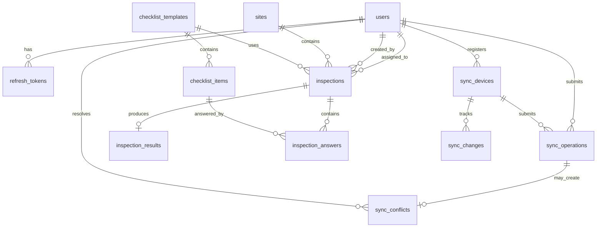

# Fieldmark — Database Design

## 1. Document Purpose

This document defines the PostgreSQL database design for **Fieldmark**, an offline-capable field inspection application.

It serves as the database implementation reference for developers and AI coding assistants.

It defines:

- Database naming and conventions.
- Database entities and relationships.
- Table structures and columns.
- Primary and foreign keys.
- Unique constraints and indexes.
- Inspection lifecycle and data relationships.
- Synchronization metadata.
- Idempotency and conflict management.
- Data integrity rules.
- Migration expectations.

The database must support multiple users, administrators, field inspectors, inspection assignments, checklist templates, inspection execution, and reliable offline synchronization.

---

## 2. Database Configuration

### 2.1 Database Name

```sql
CREATE DATABASE field_inspection_db;
```

### 2.2 Database Technology

- Database: PostgreSQL
- ORM: SQLAlchemy
- Migration tool: Alembic
- Database access: Backend only
- Frontend access: Through FastAPI APIs

### 2.3 Database Conventions

Use these conventions consistently:

| Convention | Rule |
|---|---|
| Table names | `snake_case`, plural |
| Column names | `snake_case` |
| Primary keys | UUID |
| Foreign keys | UUID |
| Timestamp fields | `TIMESTAMPTZ` |
| Boolean fields | `BOOLEAN` |
| Status values | Controlled values |
| JSON data | `JSONB` only where justified |
| Text fields | `TEXT` or bounded `VARCHAR` |
| Soft deletion | Explicit deletion metadata where needed |
| Record versions | Integer version numbers |

### 2.4 Common Column Rules

Most business tables should include:

```sql
id UUID PRIMARY KEY DEFAULT gen_random_uuid(),
created_at TIMESTAMPTZ NOT NULL DEFAULT NOW(),
updated_at TIMESTAMPTZ NOT NULL DEFAULT NOW()
```

Synchronizable records should also include:

```sql
version INTEGER NOT NULL DEFAULT 1
```

The `updated_at` field must be updated whenever a record changes.

The `version` field must increment whenever a version-controlled record is modified.

Not every table requires a version field. For example, immutable audit events and idempotency records have different lifecycle requirements.

---

## 3. Entity Relationship Overview

Fieldmark initially contains 12 core tables.



This diagram shows the main conceptual relationships. The actual SQL constraints and optional relationships are defined in the following sections.

---

# 4. Table Design

## 4.1 `users`

### Purpose

Stores administrator and inspector accounts.

### Columns

| Column | PostgreSQL Type | Constraints | Description |
|---|---|---|---|
| `id` | UUID | PK | Unique user identifier |
| `full_name` | VARCHAR(150) | NOT NULL | User's full name |
| `email` | VARCHAR(255) | UNIQUE, NOT NULL | Login email |
| `password_hash` | TEXT | NOT NULL | Argon2id password hash |
| `role` | VARCHAR(20) | NOT NULL | ADMIN or INSPECTOR |
| `is_active` | BOOLEAN | NOT NULL, DEFAULT TRUE | Account availability |
| `created_at` | TIMESTAMPTZ | NOT NULL | Creation time |
| `updated_at` | TIMESTAMPTZ | NOT NULL | Last modification time |

### SQL

```sql
CREATE TABLE users (
    id UUID PRIMARY KEY DEFAULT gen_random_uuid(),

    full_name VARCHAR(150) NOT NULL,

    email VARCHAR(255) NOT NULL UNIQUE,

    password_hash TEXT NOT NULL,

    role VARCHAR(20) NOT NULL
        CHECK (role IN ('ADMIN', 'INSPECTOR')),

    is_active BOOLEAN NOT NULL DEFAULT TRUE,

    created_at TIMESTAMPTZ NOT NULL DEFAULT NOW(),

    updated_at TIMESTAMPTZ NOT NULL DEFAULT NOW()
);
```

### Rules

- Email addresses must be normalized before storage.
- Passwords must never be stored as plaintext.
- Password hashing must use Argon2id.
- Inactive users cannot authenticate.
- Role authorization must be enforced by the backend.
- The initial MVP uses only ADMIN and INSPECTOR roles.

---

## 4.2 `refresh_tokens`

### Purpose

Stores refresh-token session information.

A refresh token allows a user to obtain a new access token without entering their password again.

### Columns

| Column | Type | Constraints | Description |
|---|---|---|---|
| `id` | UUID | PK | Session identifier |
| `user_id` | UUID | FK, NOT NULL | Associated user |
| `token_hash` | TEXT | UNIQUE, NOT NULL | Hashed refresh token |
| `device_id` | UUID | Nullable | Associated device |
| `expires_at` | TIMESTAMPTZ | NOT NULL | Expiry time |
| `revoked_at` | TIMESTAMPTZ | Nullable | Revocation time |
| `created_at` | TIMESTAMPTZ | NOT NULL | Creation time |
| `last_used_at` | TIMESTAMPTZ | Nullable | Last refresh time |

### SQL

```sql
CREATE TABLE refresh_tokens (
    id UUID PRIMARY KEY DEFAULT gen_random_uuid(),

    user_id UUID NOT NULL
        REFERENCES users(id) ON DELETE CASCADE,

    token_hash TEXT NOT NULL UNIQUE,

    device_id UUID,

    expires_at TIMESTAMPTZ NOT NULL,

    revoked_at TIMESTAMPTZ,

    created_at TIMESTAMPTZ NOT NULL DEFAULT NOW(),

    last_used_at TIMESTAMPTZ
);

CREATE INDEX idx_refresh_tokens_user_id
ON refresh_tokens(user_id);

CREATE INDEX idx_refresh_tokens_expires_at
ON refresh_tokens(expires_at);
```

### Rules

- Store a hash of the refresh token, not the raw token.
- Refresh tokens must support rotation.
- Revoked tokens cannot be used again.
- Expired tokens must be rejected.
- Refresh-token reuse detection should be considered when implementing rotation.

---

## 4.3 `sites`

### Purpose

Stores physical locations where field inspections take place.

### Columns

| Column | Type | Constraints | Description |
|---|---|---|---|
| `id` | UUID | PK | Site identifier |
| `name` | VARCHAR(200) | NOT NULL | Site name |
| `site_code` | VARCHAR(50) | UNIQUE, NOT NULL | Business identifier |
| `address` | TEXT | NOT NULL | Site address |
| `city` | VARCHAR(100) | Nullable | City |
| `state` | VARCHAR(100) | Nullable | State |
| `postal_code` | VARCHAR(20) | Nullable | Postal code |
| `country` | VARCHAR(100) | Nullable | Country |
| `description` | TEXT | Nullable | Additional details |
| `is_active` | BOOLEAN | NOT NULL | Site availability |
| `version` | INTEGER | NOT NULL | Record version |
| `created_at` | TIMESTAMPTZ | NOT NULL | Creation time |
| `updated_at` | TIMESTAMPTZ | NOT NULL | Modification time |

### SQL

```sql
CREATE TABLE sites (
    id UUID PRIMARY KEY DEFAULT gen_random_uuid(),

    name VARCHAR(200) NOT NULL,

    site_code VARCHAR(50) NOT NULL UNIQUE,

    address TEXT NOT NULL,

    city VARCHAR(100),

    state VARCHAR(100),

    postal_code VARCHAR(20),

    country VARCHAR(100),

    description TEXT,

    is_active BOOLEAN NOT NULL DEFAULT TRUE,

    version INTEGER NOT NULL DEFAULT 1
        CHECK (version > 0),

    created_at TIMESTAMPTZ NOT NULL DEFAULT NOW(),

    updated_at TIMESTAMPTZ NOT NULL DEFAULT NOW()
);

CREATE INDEX idx_sites_is_active
ON sites(is_active);
```

### Rules

- Site codes must be unique.
- Inactive sites cannot receive new inspection assignments.
- Existing inspection history must remain available when a site becomes inactive.
- Site updates must increment the record version.

---

## 4.4 `checklist_templates`

### Purpose

Stores reusable inspection checklist templates.

An administrator creates templates containing questions that inspectors must answer.

### Columns

| Column | Type | Constraints | Description |
|---|---|---|---|
| `id` | UUID | PK | Template revision identifier |
| `template_key` | UUID | NOT NULL | Stable identifier shared by all revisions of one template lineage |
| `name` | VARCHAR(200) | NOT NULL | Template name |
| `description` | TEXT | Nullable | Description |
| `template_version` | INTEGER | NOT NULL | Template revision |
| `is_active` | BOOLEAN | NOT NULL | Template availability |
| `version` | INTEGER | NOT NULL | Database record version |
| `created_by` | UUID | FK, NOT NULL | Administrator |
| `created_at` | TIMESTAMPTZ | NOT NULL | Creation time |
| `updated_at` | TIMESTAMPTZ | NOT NULL | Modification time |

### SQL

```sql
CREATE TABLE checklist_templates (
    id UUID PRIMARY KEY DEFAULT gen_random_uuid(),

    template_key UUID NOT NULL DEFAULT gen_random_uuid(),

    name VARCHAR(200) NOT NULL,

    description TEXT,

    template_version INTEGER NOT NULL DEFAULT 1
        CHECK (template_version > 0),

    is_active BOOLEAN NOT NULL DEFAULT TRUE,

    version INTEGER NOT NULL DEFAULT 1
        CHECK (version > 0),

    created_by UUID NOT NULL
        REFERENCES users(id) ON DELETE RESTRICT,

    created_at TIMESTAMPTZ NOT NULL DEFAULT NOW(),

    updated_at TIMESTAMPTZ NOT NULL DEFAULT NOW(),

    CONSTRAINT uq_template_revision
        UNIQUE (id, template_version),

    CONSTRAINT uq_template_lineage_revision
        UNIQUE (template_key, template_version)
);
```

### Rules

- Templates contain checklist items.
- All revisions of one template share the same `template_key`; each revision has its own `id`.
- Published template revisions should be immutable.
- Changes to a published template should create a new template revision.
- Existing inspections must retain the exact template revision with which they were assigned.
- Deactivating a template must not invalidate historical inspections.

---

## 4.5 `checklist_items`

### Purpose

Stores individual questions or checklist items belonging to a template.

### Columns

| Column | Type | Constraints | Description |
|---|---|---|---|
| `id` | UUID | PK | Checklist item identifier |
| `template_id` | UUID | FK, NOT NULL | Parent template |
| `question` | TEXT | NOT NULL | Question text |
| `description` | TEXT | Nullable | Additional instructions |
| `response_type` | VARCHAR(30) | NOT NULL | Expected answer type |
| `is_required` | BOOLEAN | NOT NULL | Whether answer is required |
| `display_order` | INTEGER | NOT NULL | Display position |
| `options` | JSONB | Nullable | Options for supported choice questions |
| `created_at` | TIMESTAMPTZ | NOT NULL | Creation time |
| `updated_at` | TIMESTAMPTZ | NOT NULL | Modification time |

### SQL

```sql
CREATE TABLE checklist_items (
    id UUID PRIMARY KEY DEFAULT gen_random_uuid(),

    template_id UUID NOT NULL
        REFERENCES checklist_templates(id) ON DELETE RESTRICT,

    question TEXT NOT NULL,

    description TEXT,

    response_type VARCHAR(30) NOT NULL
        CHECK (
            response_type IN (
                'YES_NO',
                'TEXT',
                'NUMBER',
                'SINGLE_CHOICE',
                'MULTIPLE_CHOICE'
            )
        ),

    is_required BOOLEAN NOT NULL DEFAULT TRUE,

    display_order INTEGER NOT NULL
        CHECK (display_order >= 0),

    options JSONB,

    created_at TIMESTAMPTZ NOT NULL DEFAULT NOW(),

    updated_at TIMESTAMPTZ NOT NULL DEFAULT NOW(),

    CONSTRAINT uq_template_item_order
        UNIQUE (template_id, display_order),

    CONSTRAINT uq_template_item_id
        UNIQUE (template_id, id)
);

CREATE INDEX idx_checklist_items_template_id
ON checklist_items(template_id);
```

### Rules

- Every checklist item belongs to one template.
- Display order must be unique within its template.
- Choice options must be validated according to response type.
- The backend must validate that submitted answers match the configured response type.
- Published template items must not be modified in place if historical inspections depend on them.

---

## 4.6 `inspections`

### Purpose

Stores inspection assignments and their lifecycle.

An administrator assigns an inspection to an inspector at a particular site using a specific checklist template revision.

### Columns

| Column | Type | Constraints | Description |
|---|---|---|---|
| `id` | UUID | PK | Inspection identifier |
| `site_id` | UUID | FK, NOT NULL | Inspection site |
| `template_id` | UUID | FK, NOT NULL | Checklist template |
| `template_version` | INTEGER | NOT NULL | Assigned template revision |
| `assigned_to` | UUID | FK, NOT NULL | Assigned inspector |
| `created_by` | UUID | FK, NOT NULL | Assigning administrator |
| `title` | VARCHAR(200) | NOT NULL | Inspection title |
| `instructions` | TEXT | Nullable | Inspector instructions |
| `scheduled_at` | TIMESTAMPTZ | Nullable | Scheduled time |
| `due_at` | TIMESTAMPTZ | Nullable | Due date |
| `status` | VARCHAR(30) | NOT NULL | Inspection lifecycle status |
| `version` | INTEGER | NOT NULL | Record version |
| `created_at` | TIMESTAMPTZ | NOT NULL | Creation time |
| `updated_at` | TIMESTAMPTZ | NOT NULL | Modification time |

### SQL

```sql
CREATE TABLE inspections (
    id UUID PRIMARY KEY DEFAULT gen_random_uuid(),

    site_id UUID NOT NULL
        REFERENCES sites(id) ON DELETE RESTRICT,

    template_id UUID NOT NULL,

    template_version INTEGER NOT NULL,

    assigned_to UUID NOT NULL
        REFERENCES users(id) ON DELETE RESTRICT,

    created_by UUID NOT NULL
        REFERENCES users(id) ON DELETE RESTRICT,

    title VARCHAR(200) NOT NULL,

    instructions TEXT,

    scheduled_at TIMESTAMPTZ,

    due_at TIMESTAMPTZ,

    status VARCHAR(30) NOT NULL DEFAULT 'ASSIGNED'
        CHECK (
            status IN (
                'ASSIGNED',
                'IN_PROGRESS',
                'SUBMITTED',
                'REVIEWED',
                'CANCELLED'
            )
        ),

    version INTEGER NOT NULL DEFAULT 1
        CHECK (version > 0),

    created_at TIMESTAMPTZ NOT NULL DEFAULT NOW(),

    updated_at TIMESTAMPTZ NOT NULL DEFAULT NOW(),

    CONSTRAINT fk_inspection_template_revision
        FOREIGN KEY (template_id, template_version)
        REFERENCES checklist_templates(id, template_version)
        ON DELETE RESTRICT,

    CONSTRAINT chk_inspection_due_date
        CHECK (
            due_at IS NULL
            OR scheduled_at IS NULL
            OR due_at >= scheduled_at
        )
);

CREATE INDEX idx_inspections_assigned_to
ON inspections(assigned_to);

CREATE INDEX idx_inspections_site_id
ON inspections(site_id);

CREATE INDEX idx_inspections_status
ON inspections(status);

CREATE INDEX idx_inspections_due_at
ON inspections(due_at);
```

### Rules

- An inspection belongs to one site.
- An inspection uses one specific template revision.
- An inspection is assigned to an inspector.
- An administrator creates the assignment.
- Only authorized users can access an inspection.
- A cancelled inspection cannot be submitted.
- Submitted inspections must follow the defined review and correction policy.
- Status transitions must be validated by the backend.

---

## 4.7 `inspection_results`

### Purpose

Stores a submitted inspection result as a distinct submission record.

A separate result table preserves submission history and avoids treating every draft update as a final inspection result.

### Columns

| Column | Type | Constraints | Description |
|---|---|---|---|
| `id` | UUID | PK | Submission identifier |
| `inspection_id` | UUID | FK, NOT NULL | Related inspection |
| `submitted_by` | UUID | FK, NOT NULL | Submitting user |
| `submission_number` | INTEGER | NOT NULL | Submission sequence |
| `submission_id` | UUID | UNIQUE, NOT NULL | Client-generated idempotency identifier |
| `submitted_version` | INTEGER | NOT NULL | Inspection version accepted at submission |
| `submitted_at` | TIMESTAMPTZ | NOT NULL | Submission time |
| `summary` | TEXT | Nullable | Inspector summary |
| `overall_status` | VARCHAR(30) | NOT NULL | Overall outcome |
| `created_at` | TIMESTAMPTZ | NOT NULL | Record creation time |

### SQL

```sql
CREATE TABLE inspection_results (
    id UUID PRIMARY KEY DEFAULT gen_random_uuid(),

    inspection_id UUID NOT NULL
        REFERENCES inspections(id) ON DELETE RESTRICT,

    submitted_by UUID NOT NULL
        REFERENCES users(id) ON DELETE RESTRICT,

    submission_number INTEGER NOT NULL
        CHECK (submission_number > 0),

    submission_id UUID NOT NULL UNIQUE,

    submitted_version INTEGER NOT NULL
        CHECK (submitted_version > 0),

    submitted_at TIMESTAMPTZ NOT NULL DEFAULT NOW(),

    summary TEXT,

    overall_status VARCHAR(30) NOT NULL
        CHECK (
            overall_status IN (
                'PASS',
                'FAIL',
                'NEEDS_REVIEW'
            )
        ),

    created_at TIMESTAMPTZ NOT NULL DEFAULT NOW(),

    CONSTRAINT uq_inspection_submission
        UNIQUE (inspection_id, submission_number)
);

CREATE INDEX idx_inspection_results_inspection_id
ON inspection_results(inspection_id);
```

### Rules

- One inspection may have multiple submission records if resubmission is allowed.
- The initial submission number is 1.
- A new submission must have a higher submission number.
- Submission history must not be overwritten.
- The client-generated `submission_id` makes repeated submission requests idempotent.
- A retried `submission_id` must reuse the same summary, overall status, and submitted version.
- The business service must determine whether a resubmission is allowed.
- Submitted answers must be preserved according to the inspection revision policy.

---

## 4.8 `inspection_answers`

### Purpose

Stores individual answers entered by an inspector for checklist items.

Draft answers must be saved independently from final submission records so they can be safely edited and synchronized offline.

### Columns

| Column | Type | Constraints | Description |
|---|---|---|---|
| `id` | UUID | PK | Answer identifier |
| `inspection_id` | UUID | FK, NOT NULL | Related inspection |
| `checklist_item_id` | UUID | FK, NOT NULL | Related checklist item |
| `answer_value` | JSONB | Nullable | Typed answer data |
| `notes` | TEXT | Nullable | Inspector notes |
| `version` | INTEGER | NOT NULL | Record version |
| `last_modified_by` | UUID | FK, NOT NULL | Last modifying user |
| `created_at` | TIMESTAMPTZ | NOT NULL | Creation time |
| `updated_at` | TIMESTAMPTZ | NOT NULL | Modification time |

### SQL

```sql
CREATE TABLE inspection_answers (
    id UUID PRIMARY KEY DEFAULT gen_random_uuid(),

    inspection_id UUID NOT NULL
        REFERENCES inspections(id) ON DELETE RESTRICT,

    checklist_item_id UUID NOT NULL
        REFERENCES checklist_items(id) ON DELETE RESTRICT,

    answer_value JSONB,

    notes TEXT,

    version INTEGER NOT NULL DEFAULT 1
        CHECK (version > 0),

    last_modified_by UUID NOT NULL
        REFERENCES users(id) ON DELETE RESTRICT,

    created_at TIMESTAMPTZ NOT NULL DEFAULT NOW(),

    updated_at TIMESTAMPTZ NOT NULL DEFAULT NOW(),

    CONSTRAINT uq_inspection_checklist_answer
        UNIQUE (inspection_id, checklist_item_id)
);

CREATE INDEX idx_inspection_answers_inspection_id
ON inspection_answers(inspection_id);
```

### Rules

- Each inspection has at most one current answer per checklist item.
- The backend must verify that the checklist item belongs to the inspection's assigned template revision.
- Answer values must match the checklist item's response type.
- Draft answers can be updated while the inspection is editable.
- Submitting an inspection must validate required answers.
- Changes to an answer must increment its version.
- Final submitted snapshots must preserve the values used for each submission.

---

## 4.9 `sync_devices`

### Purpose

Registers browser installations or devices used by authenticated users.

A user may use multiple devices.

### Columns

| Column | Type | Constraints | Description |
|---|---|---|---|
| `id` | UUID | PK | Device identifier |
| `user_id` | UUID | FK, NOT NULL | Registered user |
| `device_name` | VARCHAR(150) | Nullable | Device label |
| `device_fingerprint` | TEXT | Nullable | Optional installation identifier |
| `is_active` | BOOLEAN | NOT NULL | Device status |
| `last_seen_at` | TIMESTAMPTZ | Nullable | Last activity |
| `created_at` | TIMESTAMPTZ | NOT NULL | Registration time |
| `updated_at` | TIMESTAMPTZ | NOT NULL | Modification time |

### SQL

```sql
CREATE TABLE sync_devices (
    id UUID PRIMARY KEY DEFAULT gen_random_uuid(),

    user_id UUID NOT NULL
        REFERENCES users(id) ON DELETE CASCADE,

    device_name VARCHAR(150),

    device_fingerprint TEXT,

    is_active BOOLEAN NOT NULL DEFAULT TRUE,

    last_seen_at TIMESTAMPTZ,

    created_at TIMESTAMPTZ NOT NULL DEFAULT NOW(),

    updated_at TIMESTAMPTZ NOT NULL DEFAULT NOW()
);

CREATE INDEX idx_sync_devices_user_id
ON sync_devices(user_id);
```

### Rules

- A device belongs to one user.
- Devices must be registered through an authenticated endpoint.
- Device registration does not replace authentication.
- Revoked devices must not continue synchronizing.
- Device identifiers must not be treated as secrets or authentication credentials.

---

## 4.10 `sync_operations`

### Purpose

Stores processed synchronization operations for idempotency and auditability.

This table allows the server to recognize a retry of an operation that it already processed.

### Columns

| Column | Type | Constraints | Description |
|---|---|---|---|
| `id` | UUID | PK | Internal operation record |
| `operation_id` | UUID | UNIQUE, NOT NULL | Client-generated operation ID |
| `user_id` | UUID | FK, NOT NULL | Submitting user |
| `device_id` | UUID | FK, NOT NULL | Submitting device |
| `entity_type` | VARCHAR(50) | NOT NULL | Target entity |
| `entity_id` | UUID | NOT NULL | Target entity ID |
| `operation_type` | VARCHAR(30) | NOT NULL | CREATE, UPDATE, DELETE |
| `request_hash` | TEXT | NOT NULL | Immutable payload identity |
| `result_status` | VARCHAR(30) | NOT NULL | Processing result |
| `response_payload` | JSONB | Nullable | Stored response |
| `processed_at` | TIMESTAMPTZ | NOT NULL | Processing time |

### SQL

```sql
CREATE TABLE sync_operations (
    id UUID PRIMARY KEY DEFAULT gen_random_uuid(),

    operation_id UUID NOT NULL UNIQUE,

    user_id UUID NOT NULL
        REFERENCES users(id) ON DELETE RESTRICT,

    device_id UUID NOT NULL
        REFERENCES sync_devices(id) ON DELETE RESTRICT,

    entity_type VARCHAR(50) NOT NULL,

    entity_id UUID NOT NULL,

    operation_type VARCHAR(30) NOT NULL
        CHECK (
            operation_type IN (
                'CREATE',
                'UPDATE',
                'DELETE',
                'SUBMIT'
            )
        ),

    request_hash TEXT NOT NULL,

    result_status VARCHAR(30) NOT NULL
        CHECK (
            result_status IN (
                'ACCEPTED',
                'CONFLICT',
                'REJECTED',
                'RETRYABLE_ERROR'
            )
        ),

    response_payload JSONB,

    processed_at TIMESTAMPTZ NOT NULL DEFAULT NOW()
);

CREATE INDEX idx_sync_operations_user_id
ON sync_operations(user_id);

CREATE INDEX idx_sync_operations_device_id
ON sync_operations(device_id);

CREATE INDEX idx_sync_operations_entity
ON sync_operations(entity_type, entity_id);
```

### Rules

- The operation ID must be unique.
- The same operation ID with a different request hash must be rejected.
- The operation record and its business-data effect must be committed atomically.
- Repeated requests must return the stored outcome.
- A transient database failure must not leave an operation marked as successful when its business-data change was rolled back.
- Retention and cleanup policies must preserve idempotency for at least the supported retry period.

---

## 4.11 `sync_conflicts`

### Purpose

Stores synchronization conflicts requiring review or resolution.

### Columns

| Column | Type | Constraints | Description |
|---|---|---|---|
| `id` | UUID | PK | Conflict identifier |
| `operation_id` | UUID | FK, NOT NULL | Related operation |
| `entity_type` | VARCHAR(50) | NOT NULL | Conflicted entity type |
| `entity_id` | UUID | NOT NULL | Conflicted entity |
| `local_payload` | JSONB | NOT NULL | Submitted local state |
| `server_payload` | JSONB | NOT NULL | Current server state |
| `base_version` | INTEGER | Nullable | Version used by client |
| `server_version` | INTEGER | Nullable | Current server version |
| `status` | VARCHAR(30) | NOT NULL | OPEN, RESOLVED, DISMISSED |
| `resolution_type` | VARCHAR(30) | Nullable | Resolution action |
| `resolved_by` | UUID | FK, Nullable | Resolving user |
| `resolved_at` | TIMESTAMPTZ | Nullable | Resolution time |
| `created_at` | TIMESTAMPTZ | NOT NULL | Creation time |

### SQL

```sql
CREATE TABLE sync_conflicts (
    id UUID PRIMARY KEY DEFAULT gen_random_uuid(),

    operation_id UUID NOT NULL
        REFERENCES sync_operations(id) ON DELETE RESTRICT,

    entity_type VARCHAR(50) NOT NULL,

    entity_id UUID NOT NULL,

    local_payload JSONB NOT NULL,

    server_payload JSONB NOT NULL,

    base_version INTEGER,

    server_version INTEGER,

    status VARCHAR(30) NOT NULL DEFAULT 'OPEN'
        CHECK (
            status IN (
                'OPEN',
                'RESOLVED',
                'DISMISSED'
            )
        ),

    resolution_type VARCHAR(30)
        CHECK (
            resolution_type IS NULL
            OR resolution_type IN (
                'KEEP_SERVER',
                'KEEP_LOCAL',
                'MANUAL_MERGE',
                'ADMIN_RESOLUTION'
            )
        ),

    resolved_by UUID
        REFERENCES users(id) ON DELETE RESTRICT,

    resolved_at TIMESTAMPTZ,

    created_at TIMESTAMPTZ NOT NULL DEFAULT NOW(),

    CONSTRAINT chk_conflict_resolution
        CHECK (
            (status = 'OPEN'
                AND resolved_by IS NULL
                AND resolved_at IS NULL)
            OR
            (status IN ('RESOLVED', 'DISMISSED')
                AND resolved_by IS NOT NULL
                AND resolved_at IS NOT NULL)
        )
);

CREATE INDEX idx_sync_conflicts_status
ON sync_conflicts(status);

CREATE INDEX idx_sync_conflicts_entity
ON sync_conflicts(entity_type, entity_id);
```

### Rules

- Conflict snapshots must preserve the local and server states relevant to the conflict.
- Only authorized users may resolve a conflict.
- Resolution must create an auditable outcome.
- Resolving a conflict must not silently discard unrelated pending operations.
- The backend must revalidate the target entity before applying a resolution.

---

## 4.12 `sync_changes`

### Purpose

Provides a server-side change feed for pull synchronization.

When authorized server data changes, the backend creates a change event that connected devices can retrieve later.

### Columns

| Column | Type | Constraints | Description |
|---|---|---|---|
| `id` | UUID | PK | Change event identifier |
| `entity_type` | VARCHAR(50) | NOT NULL | Changed entity type |
| `entity_id` | UUID | NOT NULL | Changed entity identifier |
| `change_type` | VARCHAR(30) | NOT NULL | CREATE, UPDATE, DELETE |
| `entity_version` | INTEGER | Nullable | Entity version |
| `payload` | JSONB | Nullable | Change data |
| `authorized_user_ids` | JSONB | NOT NULL, default `[]` | User IDs allowed to pull this event |
| `is_global` | BOOLEAN | NOT NULL, default `false` | Whether every authenticated user may pull this event |
| `change_position` | BIGINT | NOT NULL, UNIQUE | Commit-ordered cursor position |
| `created_at` | TIMESTAMPTZ | NOT NULL | Event creation time |

### SQL

```sql
CREATE TABLE sync_changes (
    id UUID PRIMARY KEY DEFAULT gen_random_uuid(),

    entity_type VARCHAR(50) NOT NULL,

    entity_id UUID NOT NULL,

    change_type VARCHAR(30) NOT NULL
        CHECK (
            change_type IN (
                'CREATE',
                'UPDATE',
                'DELETE'
            )
        ),

    entity_version INTEGER,

    payload JSONB,

    authorized_user_ids JSONB NOT NULL DEFAULT '[]'::jsonb,

    is_global BOOLEAN NOT NULL DEFAULT FALSE,

    change_position BIGINT NOT NULL UNIQUE,

    created_at TIMESTAMPTZ NOT NULL DEFAULT NOW()
);

CREATE INDEX idx_sync_changes_entity
ON sync_changes(entity_type, entity_id);

CREATE INDEX idx_sync_changes_created_at
ON sync_changes(created_at);
```

### Implemented Cursor Design

The change event UUID is not a pull cursor. The implemented cursor is
`change_position`, backed by `sync_changes_cursor_seq` and assigned by a
`BEFORE INSERT` trigger that first acquires a transaction-scoped PostgreSQL
advisory lock. Insertion order is therefore also commit order: a later
transaction cannot be assigned (and commit) a lower position than an earlier
writer.

A rollback may leave a gap in the sequence, but it cannot leave a committed
change behind an earlier uncommitted position. Pull pagination uses the last
successfully applied `change_position` as its boundary.

The `change_position` column is filled by the database trigger and must not be
supplied by application code.

The final implementation must document the chosen approach in `offline-sync-design.md`.

### Rules

- Change events must be created transactionally with the business-data update.
- Pull results must be scoped to the authenticated user's authorized data. The backend filters by `is_global` or membership of the authenticated user ID in `authorized_user_ids` before applying pagination, so unrelated changes never consume a page slot.
- Scope metadata is stored on the change event itself, so `DELETE` tombstones remain attributable after the target row is gone.
- Deletion must be represented by a tombstone event.
- A client cursor must advance only after all corresponding events have been applied locally.
- Pagination must not skip changes.

---

# 5. Relationship Details

## 5.1 Users and Refresh Tokens

One user can have multiple refresh-token sessions.

```text
users (1) -------- (N) refresh_tokens
```

A refresh token belongs to exactly one user.

## 5.2 Users and Inspections

An administrator can create many inspection assignments.

An inspector can be assigned many inspections.

```text
users (1) -------- (N) inspections
```

The `created_by` and `assigned_to` columns both reference `users.id`, but represent different relationships.

## 5.3 Sites and Inspections

One site can have many inspections.

```text
sites (1) -------- (N) inspections
```

An inspection belongs to exactly one site.

## 5.4 Templates and Checklist Items

One template contains many checklist items.

```text
checklist_templates (1) -------- (N) checklist_items
```

Each checklist item belongs to one template.

## 5.5 Templates and Inspections

One template revision can be used by many inspections.

An inspection must retain the exact template revision used during assignment.

## 5.6 Inspections and Answers

One inspection can contain many checklist answers.

```text
inspections (1) -------- (N) inspection_answers
```

An answer belongs to one inspection and one checklist item.

## 5.7 Inspections and Results

One inspection can have multiple submission records if the business process allows resubmission.

```text
inspections (1) -------- (N) inspection_results
```

A result represents a submitted snapshot, not a mutable draft.

## 5.8 Devices and Synchronization Operations

One device can submit many synchronization operations.

One user can register multiple devices.

## 5.9 Synchronization Operations and Conflicts

A synchronization operation may produce a conflict.

A conflict preserves the local and server states that could not safely be reconciled.

---

# 6. Database Integrity Rules

The backend and database must enforce data integrity together.

### 6.1 Referential Integrity

- Every inspection must reference an existing site.
- Every inspection must reference a valid checklist template revision.
- Every inspection must reference an existing assigned inspector.
- Every checklist item must reference an existing template.
- Every inspection answer must reference an existing inspection and checklist item.
- Every submission must reference an existing inspection and submitting user.
- Every synchronization operation must reference a registered user and device.

### 6.2 User Integrity

- Email addresses must be unique after normalization.
- Only supported roles can be stored.
- Inactive users cannot perform authenticated operations.

### 6.3 Inspection Integrity

- A cancelled inspection cannot be submitted.
- Required checklist questions must be answered before submission.
- Only the assigned inspector or an authorized administrator may modify an inspection.
- Submitted data must follow the defined revision and correction rules.

### 6.4 Synchronization Integrity

- Every operation must have a unique operation ID.
- Retried operations must be idempotent.
- An operation must not be applied against an unexpected entity version.
- A conflict must preserve relevant local and server snapshots.
- Change-feed events must be committed consistently with their corresponding business-data changes.

---

# 7. Deletion Strategy

Fieldmark must distinguish between ordinary deletion and synchronization-aware deletion.

### 7.1 Users

Do not physically delete users who are referenced by inspection history.

Use account deactivation through `is_active`.

### 7.2 Sites

Prefer deactivation through `is_active`.

Existing inspections must continue to reference historical sites.

### 7.3 Templates

Published templates must not be physically deleted if existing inspections depend on them.

Use template deactivation and immutable revisions.

### 7.4 Inspections

Inspection deletion or cancellation must follow business rules.

Do not physically delete an inspection containing submitted results or important history.

### 7.5 Synchronizable Records

If a synchronizable record is deleted, generate a deletion event or tombstone.

A client must be able to distinguish:

- A record that does not exist.
- A record that was deleted on the server.
- A record that has not yet been downloaded.

Never delete dirty local data automatically just because the server reports a deletion.

---

# 8. Indexing Strategy

Indexes should support the application's most common queries.

Initial recommended indexes include:

| Table | Index | Purpose |
|---|---|---|
| `users` | `email` UNIQUE | Login lookup |
| `refresh_tokens` | `user_id` | User session lookup |
| `refresh_tokens` | `expires_at` | Token cleanup |
| `sites` | `is_active` | Active site filtering |
| `checklist_items` | `template_id` | Load template questions |
| `inspections` | `assigned_to` | Inspector assignment list |
| `inspections` | `site_id` | Site inspection history |
| `inspections` | `status` | Status filtering |
| `inspections` | `due_at` | Due-date filtering |
| `inspection_answers` | `inspection_id` | Load inspection answers |
| `sync_devices` | `user_id` | User device lookup |
| `sync_operations` | `operation_id` UNIQUE | Idempotency lookup |
| `sync_operations` | `user_id` | User operation history |
| `sync_conflicts` | `status` | Open conflict lookup |
| `sync_changes` | `entity_type, entity_id` | Entity change lookup |

Additional indexes should be introduced based on actual query patterns and query-plan analysis.

Avoid creating unnecessary indexes because every additional index increases write and storage overhead.

---

# 9. Timestamp and Version Management

### 9.1 Timestamps

Store timestamps using `TIMESTAMPTZ`.

Use UTC for server-side timestamp storage and serialization.

Convert timestamps to the user's local timezone only in the presentation layer.

### 9.2 Updated Timestamp

The backend must update `updated_at` whenever a mutable record changes.

This can be implemented through application-level update logic or carefully designed database triggers.

Use one consistent approach.

### 9.3 Version Numbers

Version-controlled records begin at:

```text
version = 1
```

Every accepted update increments the version.

Example:

```text
Original version: 1
First update:     2
Second update:    3
Third update:     4
```

The server must validate the client's base version before applying a synchronization update.

A version mismatch must follow the conflict policy.

---

# 10. Transaction Requirements

The following operations must use database transactions.

### 10.1 Inspection Submission

A submission transaction should:

1. Lock or validate the relevant inspection state.
2. Check the assigned user's permissions.
3. Validate required answers.
4. Create the inspection result snapshot.
5. Update inspection status.
6. Increment relevant versions.
7. Create synchronization change events.
8. Commit all changes together.

If any critical step fails, the transaction must roll back.

### 10.2 Synchronization Push

A push operation transaction should:

1. Validate operation identity.
2. Check whether the operation has already been processed.
3. Validate user, device, and permissions.
4. Validate the entity's current version.
5. Apply the business change or record a conflict/rejection.
6. Persist the idempotency outcome.
7. Persist corresponding change-feed events when applicable.
8. Commit the outcome atomically.

### 10.3 Synchronization Pull

Pull operations must return a consistent, authorized batch.

The change-feed cursor must follow the safe ordering design defined for the application.

The client must apply the batch to IndexedDB before committing its new local cursor.

---

# 11. SQLAlchemy and Alembic Requirements

### SQLAlchemy

- Use declarative models.
- Define explicit relationships.
- Use UUID fields consistently.
- Define foreign-key constraints.
- Define indexes and uniqueness constraints.
- Use timezone-aware timestamps.
- Keep model definitions organized by domain.

### Alembic

- All schema changes must use migrations.
- Never rely on manual production schema edits.
- Commit migration files to Git.
- Test migrations against a clean database.
- Test upgrades from the previous schema.
- Never silently remove production data through a migration.

### Migration Commands

Typical development commands:

```bash
alembic init alembic
```

After configuring the database connection and model metadata:

```bash
alembic revision --autogenerate -m "initial schema"
```

Apply migrations:

```bash
alembic upgrade head
```

Inspect migration history:

```bash
alembic history
```

---

# 12. Database Security Requirements

1. Database credentials must be stored in environment variables.
2. The frontend must never connect directly to PostgreSQL.
3. Use parameterized queries through SQLAlchemy.
4. Use a restricted database role for the application.
5. Avoid using PostgreSQL superuser credentials in the deployed application.
6. Never log passwords, access tokens, or raw refresh tokens.
7. Apply least-privilege permissions.
8. Back up production data regularly.
9. Protect inspection records and user information.
10. Keep sensitive synchronization payloads out of unnecessary logs.

---

# 13. Initial Database Creation Order

Create the tables in this dependency order:

1. `users`
2. `refresh_tokens`
3. `sites`
4. `checklist_templates`
5. `checklist_items`
6. `inspections`
7. `inspection_results`
8. `inspection_answers`
9. `sync_devices`
10. `sync_operations`
11. `sync_conflicts`
12. `sync_changes`

This ordering ensures referenced tables exist before dependent tables are created.

Use Alembic migrations to manage the actual creation order and dependencies.

---

# 14. Database Acceptance Criteria

The database design is considered implemented when:

- The `field_inspection_db` database exists.
- All 12 initial tables have been created through migrations.
- Primary keys and foreign keys are correct.
- Required unique constraints are enforced.
- Check constraints reject unsupported values.
- Inspection assignments preserve their template revision.
- Inspection drafts can be saved independently of submissions.
- Submission history is preserved.
- Synchronization operations have stable unique identifiers.
- Duplicate operations cannot create duplicate effects.
- Conflicts preserve the relevant local and server states.
- Change events are created transactionally.
- The pull cursor design cannot skip committed changes.
- Indexes support the primary application queries.
- Migrations work on a clean database.

---

# 15. Related Documentation

| Document | Purpose |
|---|---|
| `PRD.md` | Product requirements |
| `architecture.md` | Overall system architecture |
| `api-contracts.md` | API request and response structures |
| `offline-sync-design.md` | Detailed offline and synchronization behavior |
| `security-design.md` | Security and authorization |
| `frontend-design.md` | Frontend design |
| `development-phases.md` | Implementation phases |
| `testing-strategy.md` | Testing approach |
| `../AGENTS.md` | AI coding assistant instructions |

---

**End of Database Design Document**

